<!-- mcp-name: io.github.mifsopo1/mifblender -->
<p align="center">
  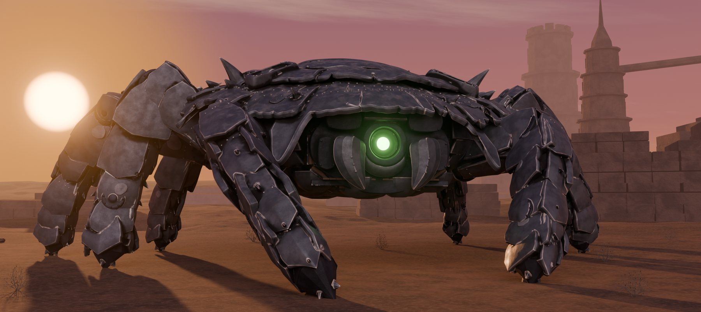
</p>

<h1 align="center">MifBlender</h1>

<p align="center"><b>Your AI assistant, working inside a running Blender.</b><br>
428 typed tools for modeling, materials, UVs, rigging, animation, physics, geometry nodes and rendering.<br>
Each one checks its parameters, does the work on Blender's main thread and reads the result back.</p>

<p align="center">
  <a href="https://pypi.org/project/mifblender-mcp/"></a>
  
  
  
</p>

## Start in one line

With [uv](https://docs.astral.sh/uv/) installed and Blender closed:

```
uvx mifblender-mcp setup
```

It finds your Blender installs and AI apps, shows what it will do and asks first. Then it installs and enables the add-on,
and adds MifBlender to the apps you pick. Restart your AI app, open Blender, and ask:

> Call bl_status, then add a rounded cube with a brushed metal material and render a preview.

Free for any use, including commercial work. No account. Everything runs on your computer.

## See what it can do

<p align="center">
  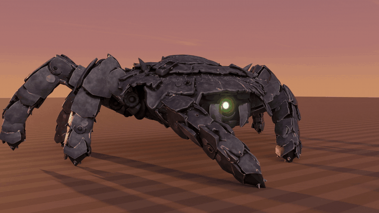
</p>

The crab walker: 515 pieces, an interior, a rig and a walk cycle, built with these tools in a long, guided session.

| The form, in clay | The topology |
|:---:|:---:|
| 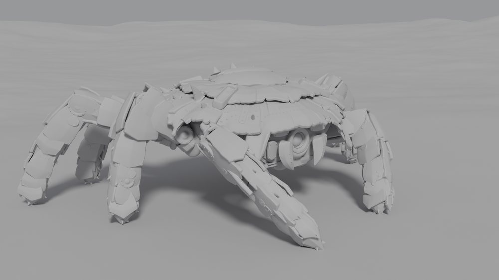 | 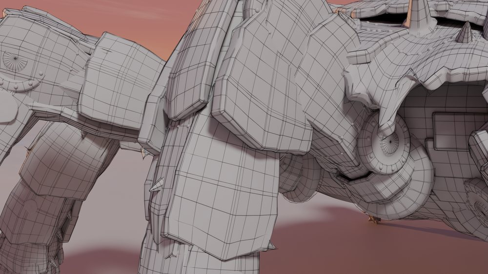 |

| The cabin | Every angle |
|:---:|:---:|
| 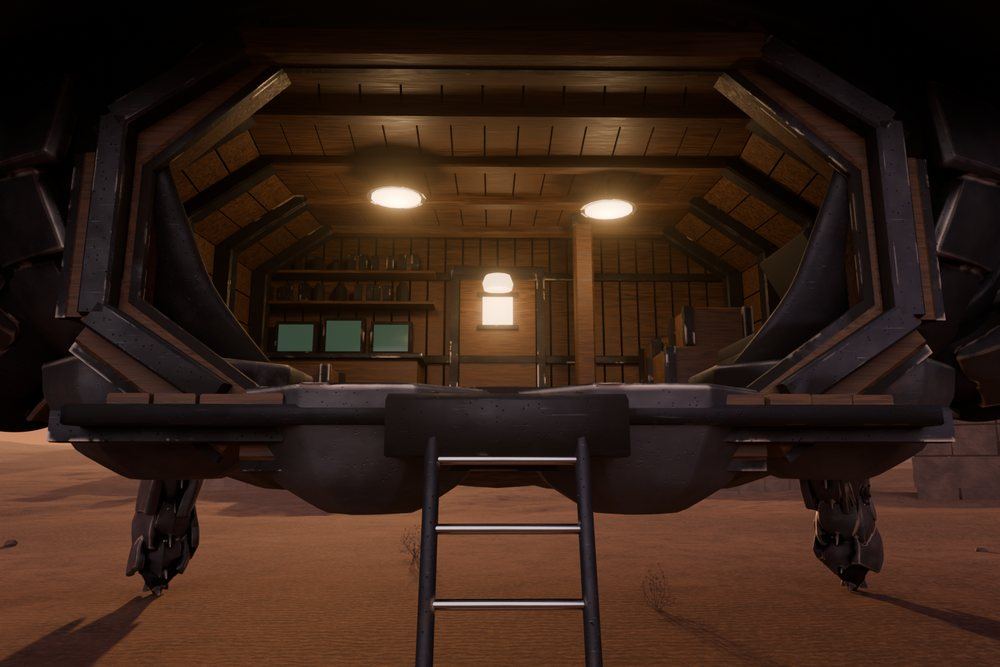 | 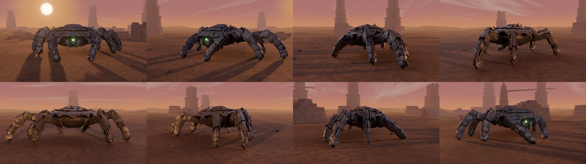 |

<p align="center">
  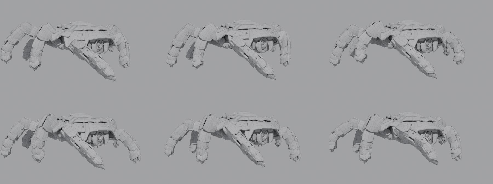
</p>

### From images to a model

The creature was built from one six-view character sheet in eight staged sessions, from blockout to a rigged walk. Each
session started fresh, with only the saved file and a running journal to go on, and every round was checked against the sheet
with `bl_compare_to_reference`.

<p align="center">
  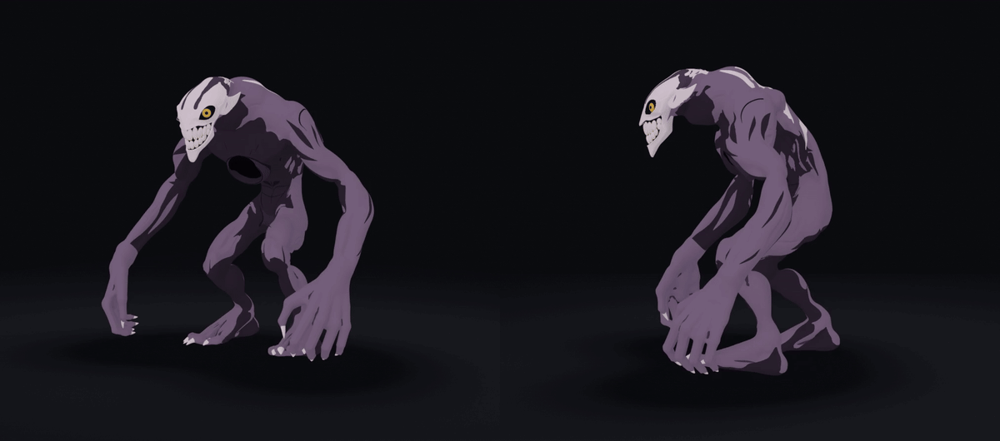
</p>

The finished model: 910,104 vertices with a painted tone on each vertex, and a 77-bone rig with IK on the arms and legs. In the
walk loop, rendered in Cycles, the planted feet slide at most 1.9 mm per frame, the last frame matches the first exactly, and the
claws stay within 0.008 mm of the fingers.

| Reference and model | The face |
|:---:|:---:|
| 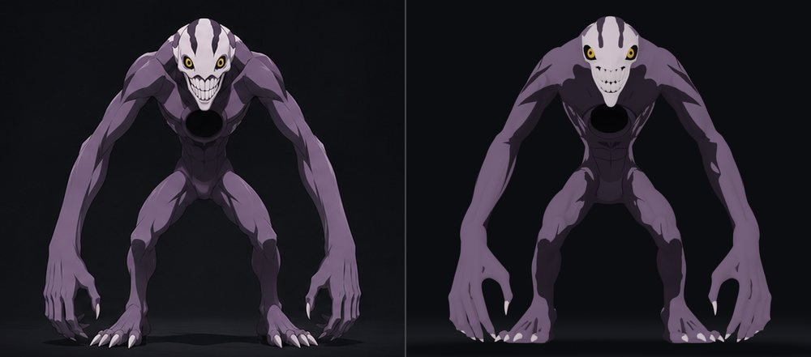 |  |

<p align="center">
  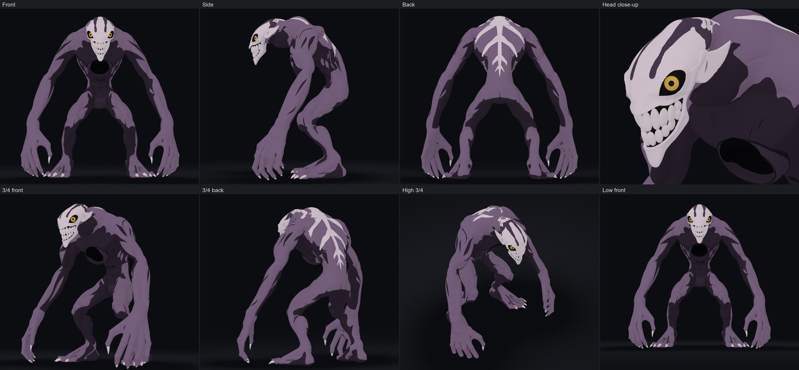
</p>

**What the build taught:**

- **A good score is not a good look.** The outline matched the sheet at .88 to .90 while the body still read as a balloon. Numbers
  catch the shape, and someone still has to look at the picture.
- **Stop when the rounds stop helping.** When the scores had been flat for half an hour, more rounds bought nothing, so the work
  moved to the next stage.
- **Reference views can disagree.** On a painted sheet, the 3/4 views did not match the front, side and back, so the build held to those three.
- **Honest numbers can fall.** Real fingers scored lower than the mitts they replaced, because the mitts had covered the painting by
  accident. Silhouette fit after the surface stage: front .85, side .89, back .84.
- **A dense mesh needs another way to weight.** Blender's heat weighting failed on a mesh this size, so the weights were computed
  from capsules around each bone instead.

### One prompt, one model

Each of these was built from the one prompt under it:

| | |
|:---:|:---:|
| 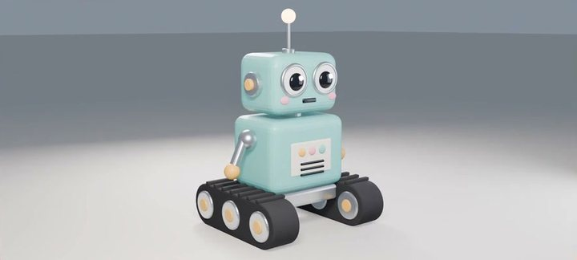<br><sub>"Model a cute boxy robot with antenna, round eyes and tank treads, lit for a nice render."</sub> | 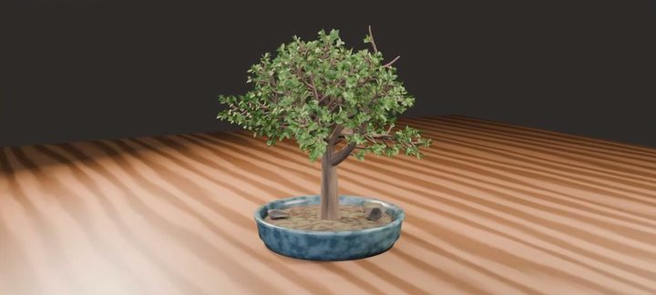<br><sub>"Model a bonsai tree in a shallow ceramic pot with a few small rocks, lit for a nice render."</sub> |
| 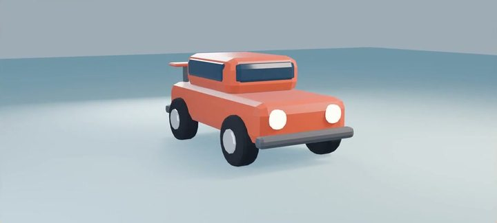<br><sub>"Model a low-poly cartoon car with round wheels, headlights and a little spoiler, lit for a nice render."</sub> | 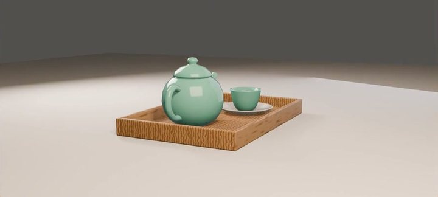<br><sub>"Model a cute ceramic teapot with a cup and saucer on a small wooden tray, lit for a nice render."</sub> |
| 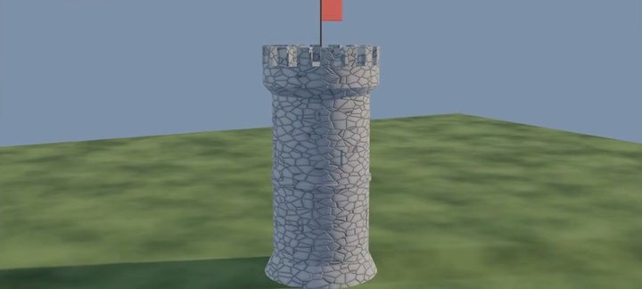<br><sub>"Model a stone castle tower with battlements, arrow slits and a flag on top, lit for a nice render."</sub> | 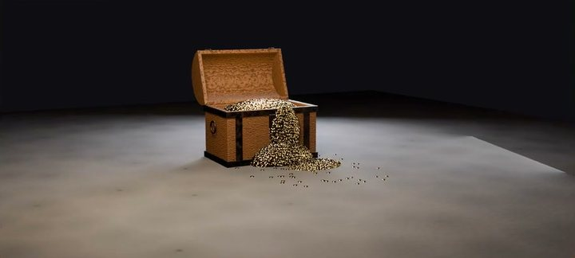<br><sub>"Model a wooden treasure chest with iron bands, its lid open, and gold coins spilling out, lit for a nice render."</sub> |

### Simulation, shading and scale

Scripted scenes, each built entirely from typed calls:

| | | |
|:---:|:---:|:---:|
| 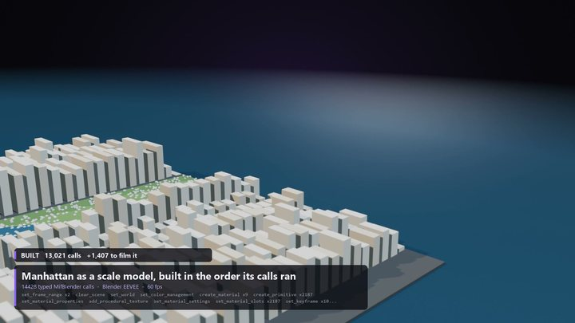<br><sub>Manhattan as a scale model</sub> | 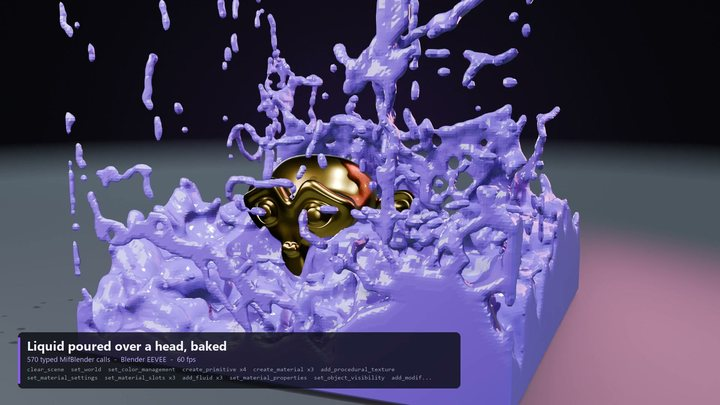<br><sub>A baked liquid sim</sub> | 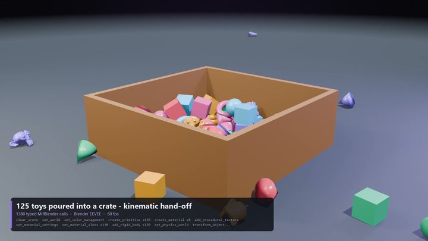<br><sub>125 rigid bodies</sub> |
| 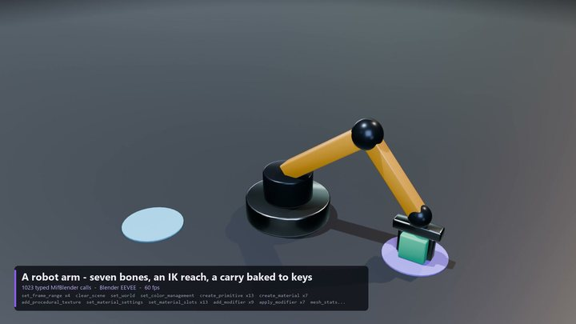<br><sub>IK with a baked carry</sub> | 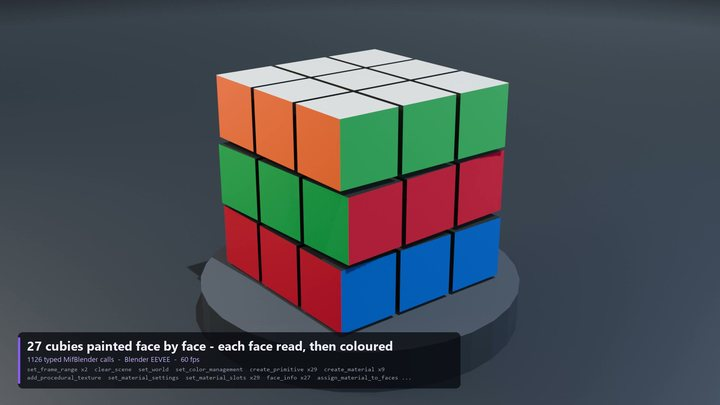<br><sub>27 cubies, painted face by face</sub> | 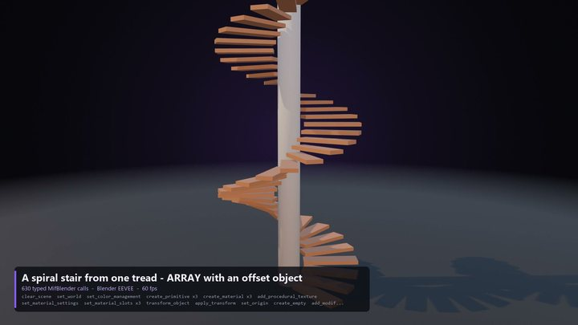<br><sub>A spiral stair from one tread</sub> |
| 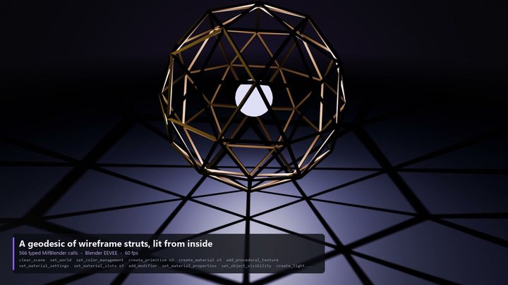<br><sub>A geodesic lit from inside</sub> | 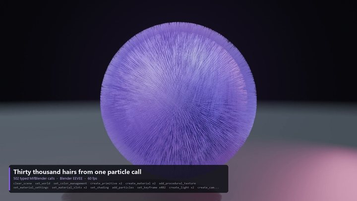<br><sub>30,000 hairs from one call</sub> | 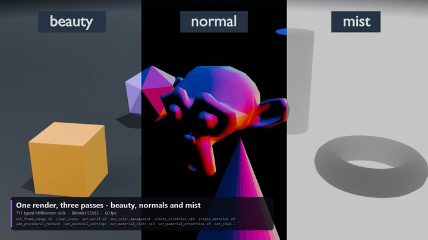<br><sub>Render passes</sub> |

### Game props

| Clean to worn, from one setting | Topology you can check |
|:---:|:---:|
| 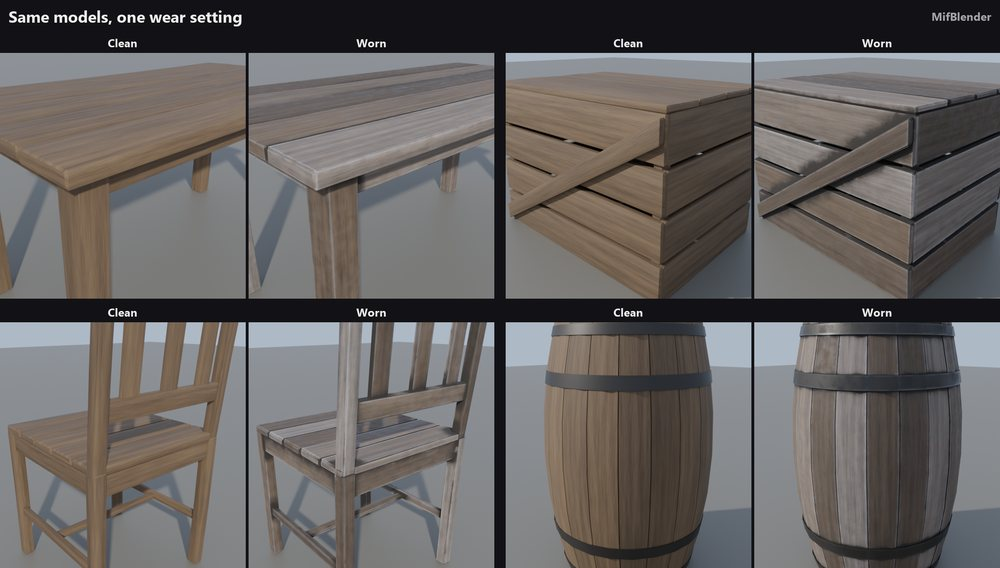 | 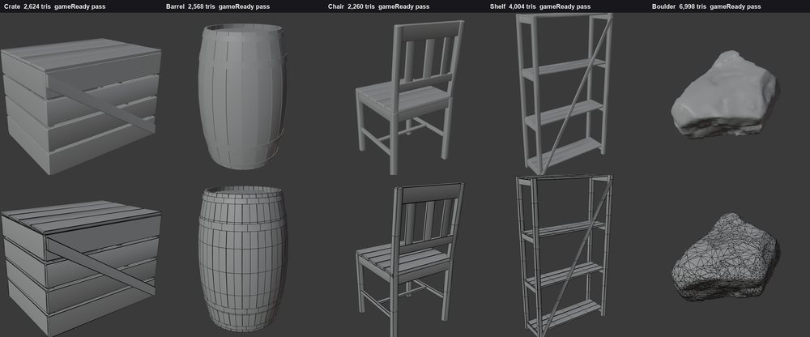 |

## What is in it

| Area | Examples |
|---|---|
| **Modeling** | primitives, mesh editing, bevels, booleans, modular kit pieces, rocks and trees built by rule |
| **Materials and UVs** | shader node graphs, texture sets, baking, unwrapping |
| **Rigging and animation** | armatures, Rigify, poses, keyframes, walk cycles |
| **Simulation** | rigid bodies, cloth, particles, geometry nodes |
| **Rendering** | lights, cameras, Cycles and EEVEE stills and sequences, compositing |
| **Checking** | mesh quality reports, comparing a render to a reference image, reading results back |

A lean default sends only `find_tools`, `mif_call` and `run_python` up front and finds the rest on demand, so a long session
stays small. Set `MIF_TOOL_PACKS=blender` to load all 428 tools, or name the packs you want; there are 13.

## AI apps

`setup` knows Claude Code, Claude Desktop, Cursor, Windsurf, VS Code and Codex. For any other MCP client, start this as a stdio
server:

```
uvx mifblender-mcp
```

Useful setup options: `--dry-run` shows the plan and changes nothing, `--check` reports what is set up, `--upgrade` moves the
add-on and the apps to this version together, and `--uninstall` removes them. If several Blenders are found, it asks which.

## Settings

Set these in the client's `env` block when you need them:

| variable | default | |
|---|---|---|
| `MIF_BLENDER_PORT` | `8792` | the port the add-on listens on |
| `MIF_BLENDER_TOKEN` | set by `setup` | must match the add-on's **Token** preference |
| `MIF_TOOL_PACKS` | `lean` | `lean`, `blender`, or a list of packs |
| `MIF_BLENDER_TIMEOUT` | `180` | seconds one call may take |

## Safety

- Everything stays on your computer. The add-on listens on `127.0.0.1` only, and `setup` generates a private token that links
  it to your AI apps. Neither makes any network call of its own.
- **`run_python` is on by default and runs any Python inside Blender.** Untick **Allow run_python** in the add-on's preferences
  to limit the assistant to the typed tools.
- The `bl_gen_*` tools are generative: they send a prompt to a ComfyUI you run yourself, and do nothing without one. Every other
  tool builds from explicit parameters. Set `MIF_GENERATIVE=off`, or untick **Allow generative tools**, to switch them off.

## Tested on

Blender 3.6.23, 4.2.17, 4.4.0, 5.0.1 and 5.2.1, on Windows. macOS and Linux have not been tested yet; reports are welcome.

## License

**Free, source available.** The add-on is MIT. The server is free for any use, including commercial work, and you may share it
unchanged through the channels its license names; you may not sell it or publish changed copies. It is not an open source
license. See [LICENSE.txt](LICENSE.txt). Some comments cite internal documents that are not published.

## MifBridge

MifBlender is the Blender half of [MifBridge](https://mifshowcase.store/mifbridge), a paid product that adds Unreal Engine 5.3 to
5.8 and the tools that move models between the two. MifBlender stands on its own and needs neither.

Questions and bug reports: [open an issue](https://github.com/mifsopo1/MifBlender/issues).
